# Advanced Clinical Database — سیستم جامع مدیریت کلینیک

A networked clinic management system in Persian (RTL) for **کلینیک OPD سلامت خانواده**.
Every department runs its **own desktop program on its own computer**; all of them share **one database** on the Admin PC over the clinic's local network (WiFi / LAN).

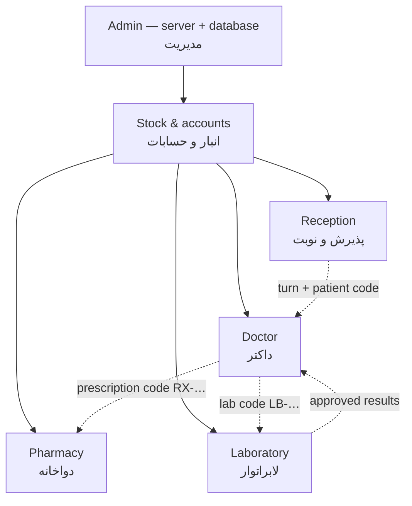

| Program | Who uses it | What it does |
|---|---|---|
| **Clinic Admin** | clinic manager | Runs the server and the SQLite database. Sees and edits everything: all stations' pages, users & roles, doctors, services & fees, letterhead/prescription settings, live network map, audit log, backups. |
| **Clinic Stock** | stock & accounts | Medicine catalogue with numeric codes, purchase factors (company, factor no., buy price, markup %, sell price, batch, expiry), payment status: paid / installment / unpaid with every installment, suppliers' balances, other factors & expenses (مصارف), withdrawals, daily accounts (like *حسابات ماهوار*), monthly profit, per-medicine profit, stock value, low-stock and expiry alerts, Excel import. |
| **Clinic Reception** | reception desk | Registers patients (name, father's name, sex, age in years / months / days for children, phone, address, weight, height, emergency contact, insurance), service (OPD, US, ECG… or typed manually / added as a new service), doctor from a searchable picker grouped by department (add doctors with department, type of work, room and weekly schedule), fee & discount, turn number per doctor, reservations, receipt with turn number + patient code + barcode. **Central cashier**: every payment of the clinic — doctor fees, laboratory, pharmacy, beds, patient deposits, refunds — is received here; **laboratory registration** linked to the lab reception; **beds / in-patients** (admit, transfer, charges, discharge bill); waiting-room **TV display** with calling; **day accounts** of all sections and cash hand-over. |
| **Clinic Doctor** | each doctor | Live queue (with *call* to the TV display and admitted patients), patient file (history, allergies, chronic illnesses, previous visits, prescriptions and lab results, vital-sign trends), visit form (BP, PR, RR, T, weight, height, SpO₂…), prescription with form/strength/dose/frequency/timing/duration/quantity + note per medicine, prescription templates, lab request, discount on fee / pharmacy / lab, **choose which sections are printed** plus a free note, print on the clinic letterhead (A5/A4), ICD-10 codes, BMI, warnings for allergy / drug interaction / duplicate medicine / repeated lab test, same-generic alternatives for out-of-stock medicines. |
| **Clinic Pharmacy** | pharmacy | Prescriptions arrive live; type or scan the **prescription code** → items matched to stock, prices and the doctor's discount calculated → sale with **two receipts** (pharmacy copy + patient copy with how-to-use), walk-in sales, returns to the same batch, daily totals and withdrawals; in *central cashier* mode the sale is billed and paid at reception (the receipt says so); same-generic alternatives; re-order suggestions. |
| **Clinic Lab** | laboratory | Requests arrive live with a **lab code** (from doctors or from the reception) → bill with discount and **two receipts**, sample-taken time and tube labels, result entry on **one page per department** (Enter moves to the next page) with automatic flags (H/L/critical) from age- and sex-specific normal ranges, a comment per test for the doctor, calculated values, approval sends results to the doctor, A4 report with configurable font (incl. Viner Hand ITC), size, weight, paragraph spacing, table grid, section alignment, Persian patient box and the address fixed at the page bottom; active / inactive tests; **materials store** (reagents) consumed automatically by each registered test; lab sales. Also (from the lab's previous program): **reception types / insurance contracts** (free or insurance rate, patient and organisation share, increase %, maximum tests, required fields), **outside referring doctors** with medical council number, fasting / non-fasting / urgent / pregnant / sample flags and clinical notes, automatic **answer date** from turnaround days and the weekdays a test is done, warnings for repeated tests and duplicate national ID, discount reason and giver, **previous answers (Prev 1–4)** and a trend chart per test, ready and default answers, **reagent kits** with lot number, expiry and method, alarm / critical / possible ranges, re-applying ranges to a date range, send-out tests, LOINC and machine codes, **patient statistics** (settled / debtor / creditor, urgent, discounts by giver, cash and card, repeated tests, receptions per hour, per test and per reception type, printable with a totals page) and **referring doctors' income** with a monthly trend chart; report with ▲▼ arrows, coloured abnormal names, differential in a side column, Fast / Urgent / Clinical Notes line and two signatures. |

Every station has light / dark / automatic mode and its own colour (Admin → settings → station colours, or *this computer*).

## Codes
`P-10001` patient · `V-000001` reception receipt · `RX-00001` prescription (pharmacy only) · `LB-00001` laboratory · `PH-000001` pharmacy sale · `F-00001` purchase factor · `IP-00001` admission · medicines `1001, 1002…`.
Numbers can be typed without the prefix (e.g. `12` opens `RX-00012`) and every receipt carries a Code-128 barcode for scanners.

## Install
1. Download the installers from the latest successful run in **[Actions](../../actions)** (artifacts *Clinic-Admin*, *Clinic-Stock*…), or from **Releases** after pushing a version tag (`git tag v1.0.1 && git push origin v1.0.1`). Each works on Windows 7, 8, 10 and 11, 32- and 64-bit.
2. On the main computer install **Clinic-Admin-Setup** and open it. First login: `admin` / `1234` (you will be asked to change it). If Windows Firewall asks, click **Allow**.
3. In Admin → *کاربران و دسترسی* create a user for each station (reception, doctors — linked to their doctor profile —, pharmacy, stock, lab).
4. On every other computer install the program of that department. It finds the Admin PC on the network automatically; otherwise type the address shown in Admin → *شبکه و ایستگاه‌ها* (e.g. `192.168.1.10:8750`).
5. Any device on the network can also open the system in a browser: `http://<admin-ip>:8750/?station=pharmacy`.

The database is `clinic.sqlite` in the Admin PC's app-data folder (`%APPDATA%\Clinic Admin\data`); a backup is made every day (keeps 30) and can be downloaded/restored from *پشتیبان دیتابیس*.
Import the old Excel book (`Database.xlsx`: sheets *stock*, *مصارف*, *حسابات ماهوار دواخانه*, *Medicines*) from Stock → *ورود اطلاعات از اکسل*.

## Screenshots
| | |
|---|---|
| Network map 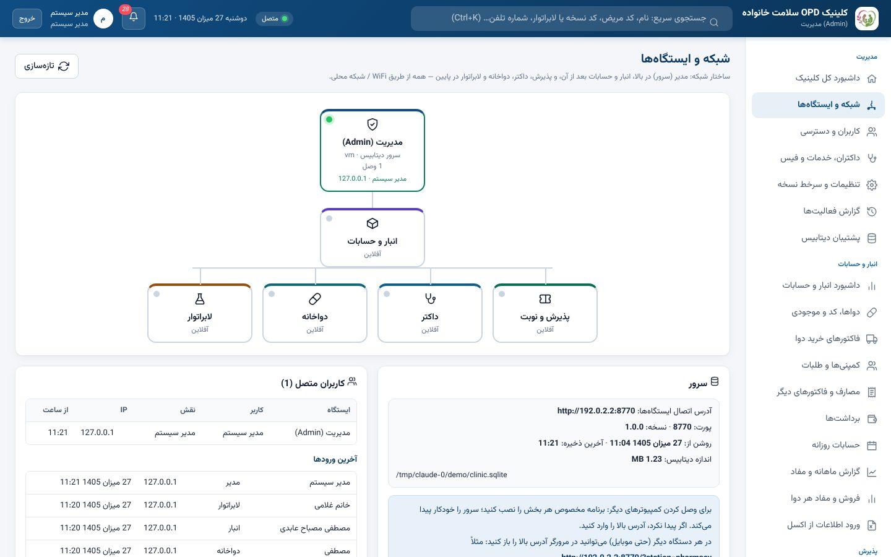 | Admin dashboard 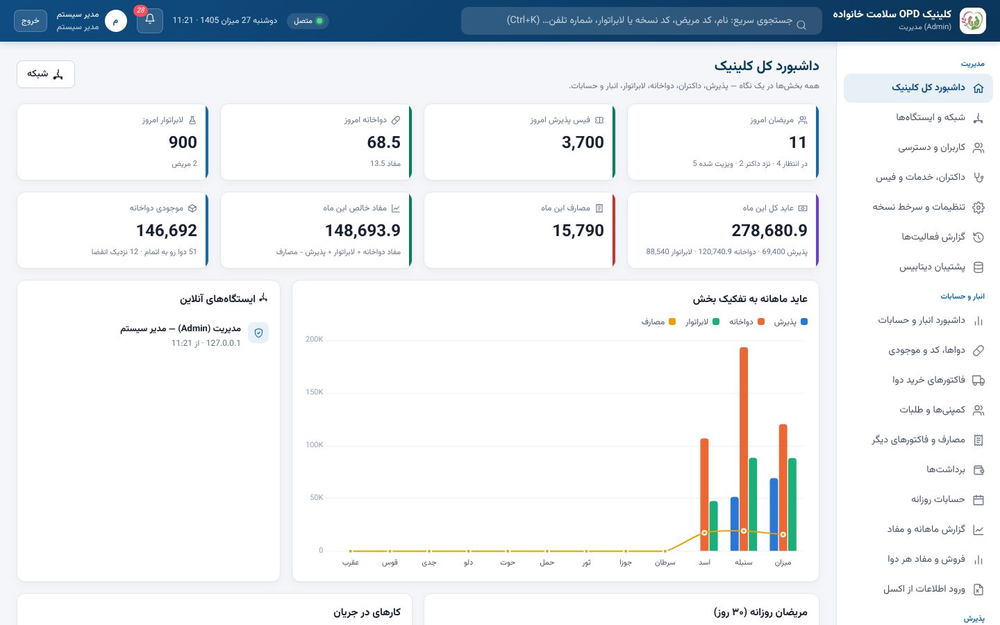 |
| Reception 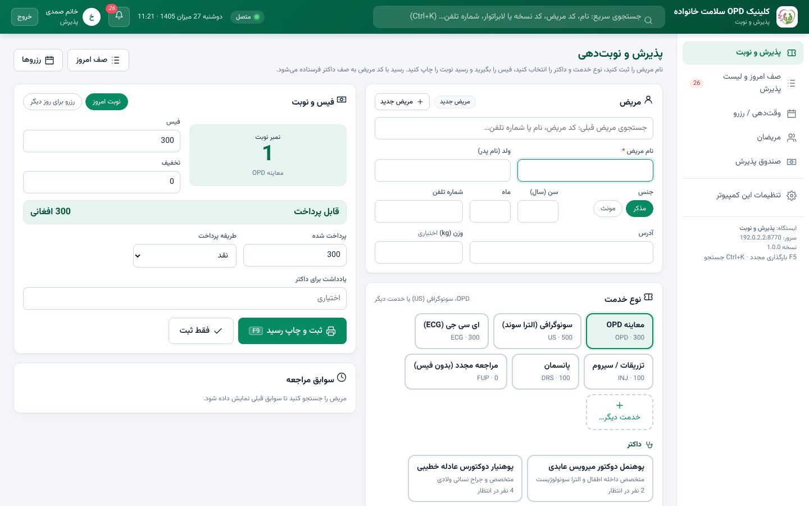 | Reception receipt 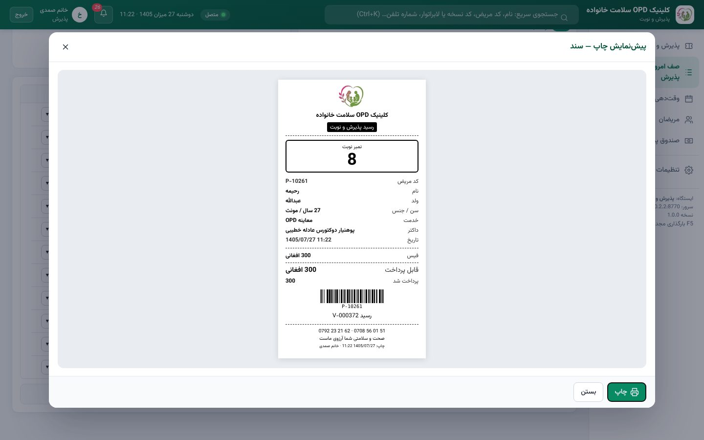 |
| Doctor queue 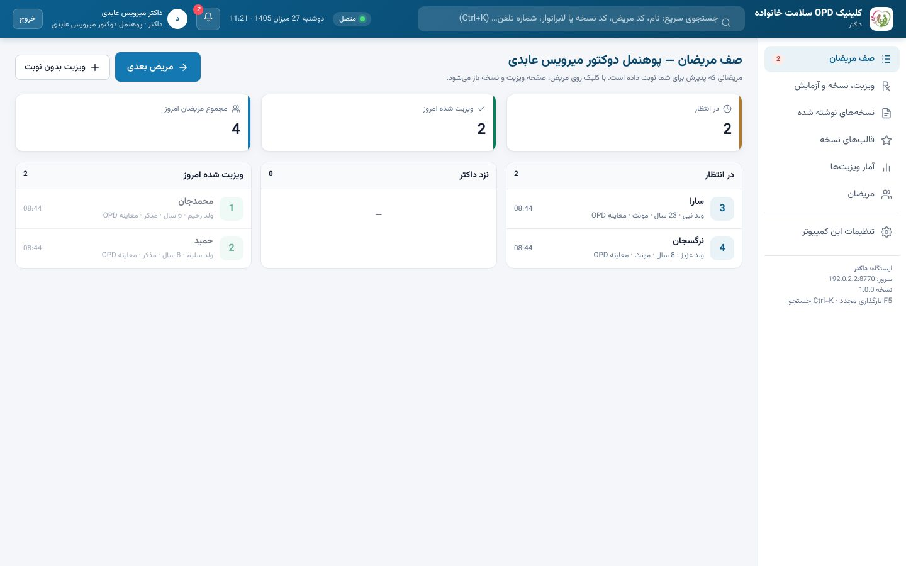 | Visit & prescription 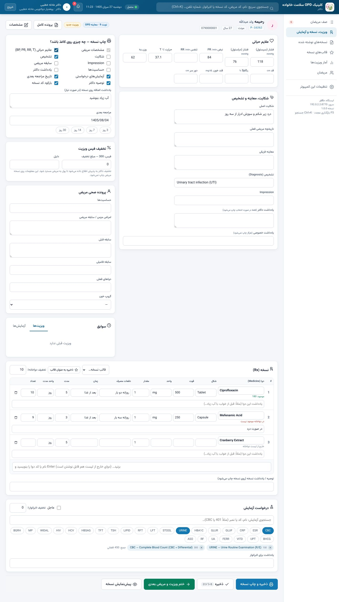 |
| Printed prescription (letterhead) 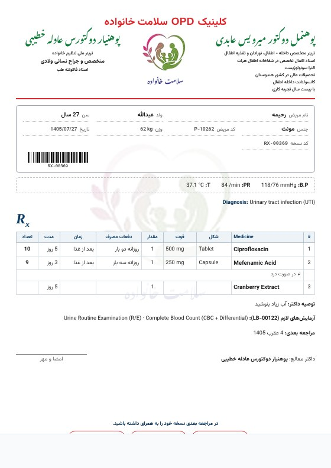 | Pharmacy — dispensing by code 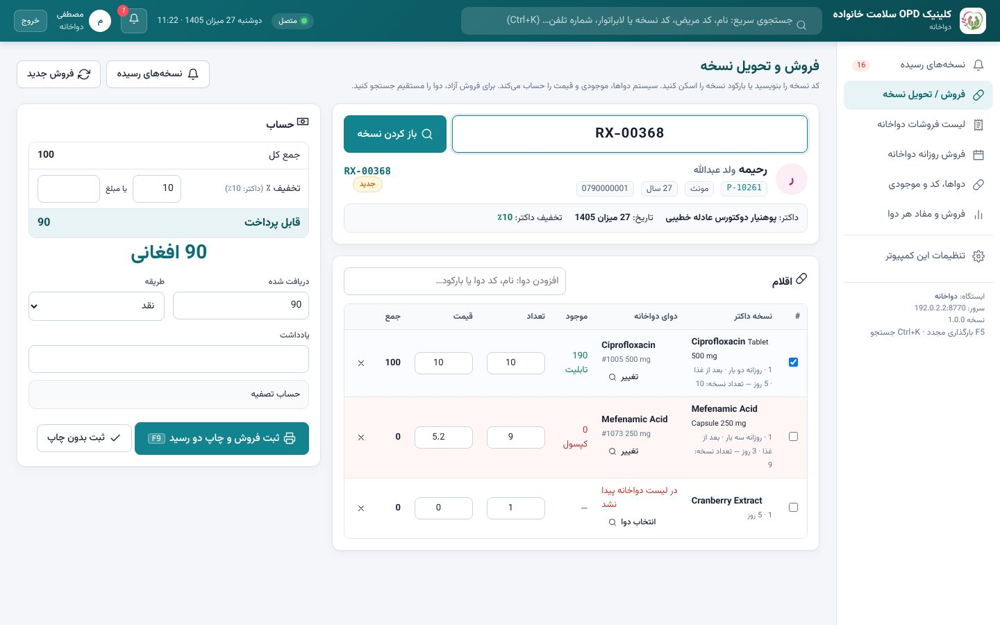 |
| Pharmacy — two receipts 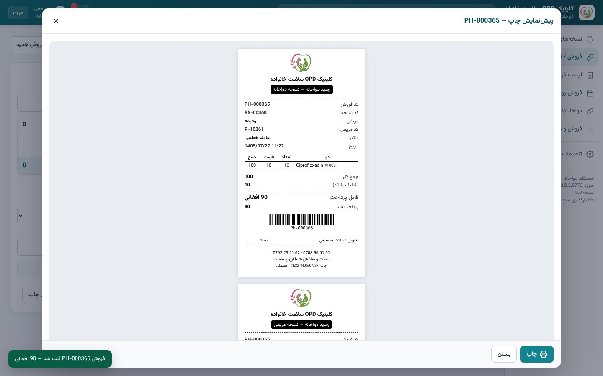 | Lab results 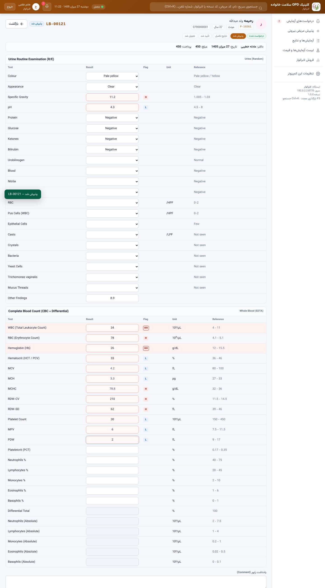 |
| Lab report 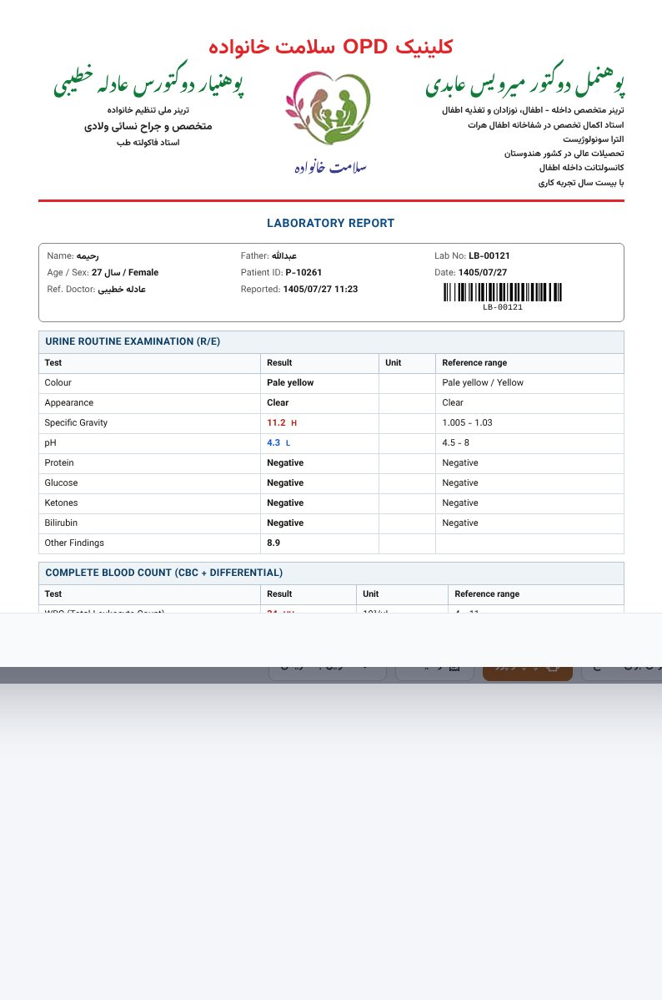 | Stock dashboard 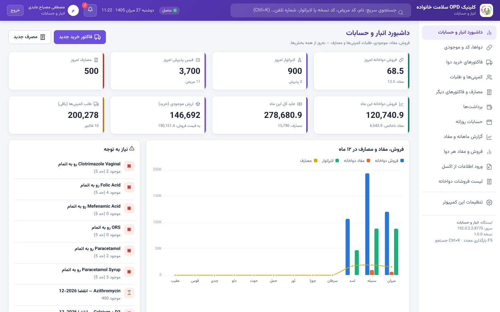 |
| Purchase factor & installments 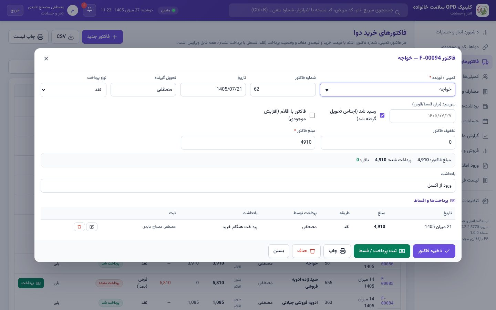 | Daily accounts 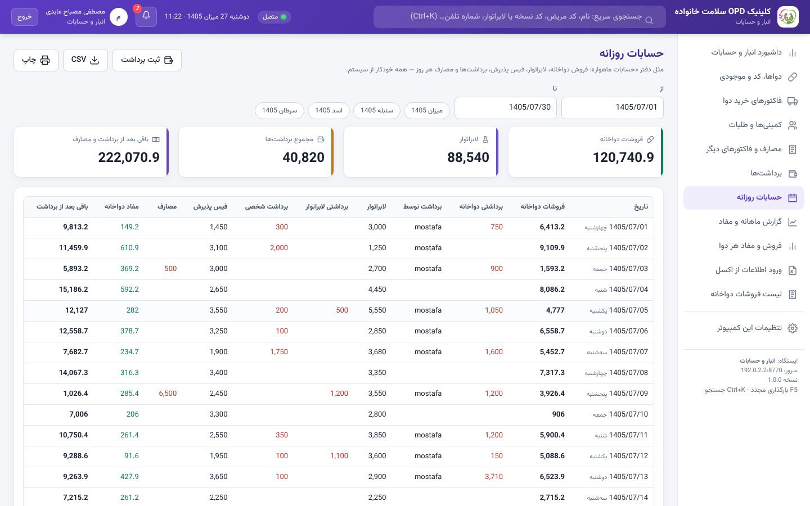 |

## Technical
- Electron 22 (last version supporting Windows 7), one code base, six station builds (`scripts/build-station.js`, GitHub Actions builds all installers).
- Server (`server/`): Node HTTP + JSON API with per-role permissions, Server-Sent Events for live updates, UDP broadcast for auto-discovery, SQLite via sql.js (no native modules), atomic saves, daily backups, audit log. Can also run headless: `npm run server`.
- UI (`renderer/`): plain HTML/CSS/JS served by the server, Persian RTL, solar (حمل، ثور…) calendar and date picker, Chart.js, Vazirmatn & Noto Nastaliq fonts.
- Tests: `npm test` (full API workflow), `npm run demo -- ./data` (demo data), `scripts/ui_test.py` / `ui_flow.py` / `ui_flow2.py` / `ui_flow3.py` (Playwright).
- Waiting-room display: `http://<admin-ip>:8750/display.html` on any TV / browser (or the button in reception).
- Database upgrades itself on start (schema v3: cashier, deposits, beds, lab materials, departments, schedules, reception types, referrers, kits); old data is kept.

## راهنمای کوتاه
- **کمپیوتر مدیر** را اول نصب و روشن کنید؛ تا وقتی این برنامه باز است، بقیه بخش‌ها کار می‌کنند.
- **پذیرش**: نام مریض ← خدمت (OPD / سونوگرافی / خدمت دیگر) ← داکتر ← فیس ← «ثبت و چاپ رسید» (F9). مریض فوراً در صف داکتر دیده می‌شود.
- **صندوق مرکزی** (پذیرش): همه پول‌ها — فیس داکتر، لابراتوار، دواخانه، بستر و پول امانت — اینجا گرفته می‌شود؛ «حسابات روز و تحویل صندوق» حساب کل روز است.
- **پذیرش لابراتوار** (در پذیرش): مریض ← مخفف آزمایش‌ها ← دریافت پول و چاپ رسید؛ درخواست فوراً به لابراتوار می‌رسد.
- **داکتر**: از «صف مریضان» مریض را باز کنید، علایم حیاتی و تشخیص را بنویسید، دوا و آزمایش اضافه کنید، انتخاب کنید چه چیزی روی نسخه چاپ شود، «ذخیره و چاپ نسخه». نسخه با کد RX به دواخانه و آزمایش با کد LB به لابراتوار می‌رود.
- **دواخانه**: کد نسخه را بنویسید یا اسکن کنید، تعداد و تخفیف را ببینید، «ثبت فروش و چاپ دو رسید».
- **لابراتوار**: کد LB را وارد کنید ← پذیرش (در حالت صندوق مرکزی پول در پذیرش گرفته می‌شود) ← نمونه و لیبل ← ثبت نتایج صفحه به صفحه ← «تأیید نهایی و ارسال به داکتر» ← چاپ راپور. تنظیمات فونت و جدول راپور در مدیر ← تنظیمات ← راپور لابراتوار.
- **انبار**: فاکتور خرید با اقلام، فیصدی مفاد و وضعیت پرداخت؛ قسط‌ها در همان فاکتور ثبت می‌شود؛ مصارف جداگانه؛ حسابات روزانه و مفاد ماهانه خودکار.

Made by Mostafa Mesbah Aabedi · MIT License
